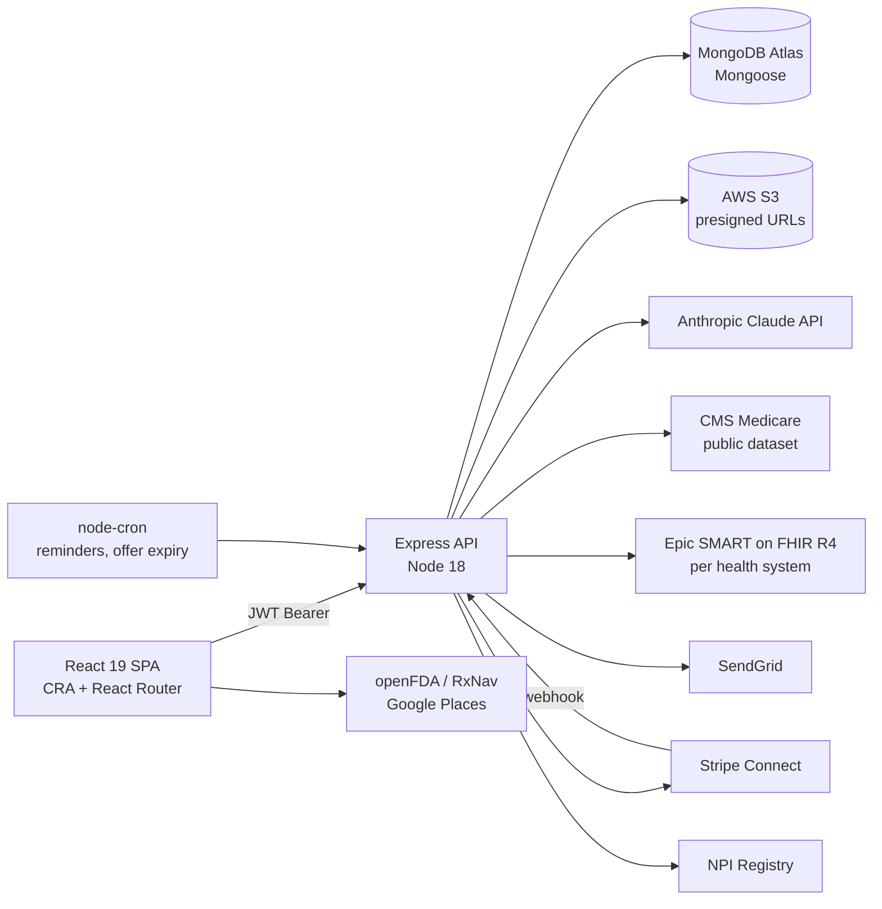

# MyMedicalCabinet

A patient-held health record web app: medications, doctors, appointments, insurance, medical bills and documents in one account, with Epic MyChart import over SMART on FHIR and AI explanations of bills and medical documents.

**Live:** https://mymedicalcabinet.com

This is the current version of the product. An earlier v1 (plain HTML and Express sessions) lives at [silverfoxmediaco/mymedicalcabinet](https://github.com/silverfoxmediaco/mymedicalcabinet).

<!-- screenshots: add docs/screenshot-*.png -->

## The problem

A patient's record is split across every health system they have visited, and each portal only shows its own slice. When someone sees a new doctor, lands in an ER, or manages care for a parent, they rebuild their medication list and history from memory. Medical bills add a second problem: they arrive as dense CPT-coded statements with no reference point for what a fair price is, and most people pay them as billed.

## What I built

I designed and built the whole stack on my own: the React client, the Express API, the MongoDB data model, the Epic and insurer OAuth integrations, the Claude prompts for document and bill analysis, the Stripe Connect payment flow, the admin panel, and the deployment on Render.

## Key features

- **Records by category.** Medications, medical history (conditions, allergies, surgeries, events), doctors, appointments, insurance and bills each have their own page, CRUD API and Mongoose model.
- **Family members.** One login can hold records for dependents. Every model carries a `familyMemberId` (null for the account holder), and a server middleware checks ownership before any scoped read or write.
- **Epic MyChart import.** Users pick their health system, authorize through Epic, and the server pulls their clinical data and maps it into the app's own models (details below).
- **AI document explainer.** Uploaded lab reports and records are sent to Claude with a prompt that returns a plain-language summary, key findings, defined terms and questions to ask the doctor. Results are saved on the document so a repeat view does not call the API again.
- **AI bill analysis.** The server first asks Claude to pull CPT codes and the patient's state from the bill, looks those codes up in the public CMS Medicare dataset, then sends the bill plus the Medicare figures back to Claude. The response is structured JSON: line items with a fair-price estimate, flagged errors (duplicate charge, upcoding, unbundling and similar), totals, a recommended offer and a draft dispute letter. Multi-page PDFs over a page threshold fall back to text extraction with `pdf-parse`.
- **Insurance explainer.** The same pattern applied to insurance documents (EOBs, plan summaries).
- **Bill settlement with the biller.** A patient can send a settlement offer to a billing office by email. The biller opens a link, verifies with a one-time code, and can accept, reject or counter. On acceptance the biller onboards to a Stripe Connect Express account and the patient pays through a PaymentIntent with an application fee. Unanswered offers expire through a nightly cron job.
- **Record sharing.** A patient can share selected record categories with a provider by email. The recipient gets a 6-digit code (stored as a bcrypt hash, locked for 30 minutes after 5 failed attempts) and receives a short-lived session token to view the records. Shares can be revoked, and views and downloads are logged.
- **Medication barcode scan.** The camera scanner (`html5-qrcode`) reads a package barcode and looks up the NDC or UPC in openFDA to fill in the drug.
- **Insurance card scanning.** Card photos are read client-side with `tesseract.js` and parsed into insurance fields.
- **Doctor lookup** against the NPI Registry, plus pharmacy and address search through Google Places.
- **Appointments** with add-to-calendar links (Google, Outlook, Yahoo, `.ics`), visit summaries, and email reminders for appointments, doses and refills processed by a cron job every 15 minutes.
- **Intake form** that pre-fills from stored records and adds social, past medical and family history checklists.
- **Admin panel** at `/admin` with its own login, separate JWT secret and Admin model, for user management and usage stats.

## Architecture

The Express server serves the API under `/api`, a set of static HTML marketing and SEO pages, and the React build. Uploaded documents go to S3 and are reached through presigned URLs (5 minutes for upload, 1 hour for download). Two `node-cron` jobs run inside the server process.



## Integrations worth noting

### Epic SMART on FHIR (`server/routes/epic.js`, `server/services/epicFhir.js`)

1. `GET /api/epic/authorize` takes an optional `healthSystemId`, loads that system's `authorizeUrl`, `tokenUrl` and `fhirBaseUrl` from the `HealthSystem` collection (falling back to Epic's sandbox), and builds an authorization-code request with a random 32-byte `state` and `aud` set to the FHIR base URL.
2. Scopes are SMART v2 patient read/search: `Patient`, `MedicationRequest`, `AllergyIntolerance`, `Condition`, `Immunization`, `Encounter`, `Procedure`, `DiagnosticReport`, `Observation`, `Coverage`, `ExplanationOfBenefit`, `Practitioner`, `Organization`, plus `openid fhirUser launch/patient`.
3. `GET /api/epic/callback` checks `state`, exchanges the code at the health system's token endpoint as a confidential client (Basic auth with that system's client secret), reads the `Patient` resource to confirm identity, and upserts one `EpicConnection` per user and family member.
4. `POST /api/epic/sync` fetches `MedicationRequest`, `Condition`, `AllergyIntolerance`, `Immunization`, `Procedure` and `Encounter` in parallel with `Promise.allSettled`, collects every `Practitioner` reference across those resources and fetches each one, then hands the bundle to `fhirMappingService`.
5. The mapping service converts each resource into the app's models. It matches on the FHIR resource id first, then links to a manually entered record with the same name, so a second sync updates rather than duplicates. It returns created, updated and skipped counts per category.
6. Access tokens are refreshed with the refresh token when within 5 minutes of expiry.

Health systems are seeded from Epic's published endpoint list (`server/scripts/epicEndpoints.json`, 490 organizations) with manual overrides for R4 endpoints. Each system's client secret is stored encrypted with AES-256-GCM and decrypted only for token exchange.

### Insurer FHIR (`server/services/fhirService.js`)

A provider-config module for payer Patient Access APIs, with entries for Wellmark BCBS and Humana (`Coverage` and `ExplanationOfBenefit` scopes). It is wired to connect, callback and sync routes on the insurance page, with token refresh where the payer supports it.

### Stripe Connect (`server/services/stripeService.js`, `server/routes/stripeWebhook.js`)

Billers get Express accounts. Payments use `transfer_data.destination` with an `application_fee_amount` set by `STRIPE_PLATFORM_FEE_PERCENT` (default 10). The webhook is mounted with `express.raw()` ahead of the JSON parser so the signature can be verified, and it records payments against the bill on `payment_intent.succeeded`.

## Data and security handling

- **Auth:** email and password with bcrypt, email verification, password reset, and JWTs (default 7-day expiry) sent as a Bearer header. Admins use a separate token and secret.
- **Secrets:** every credential is read from environment variables; nothing is committed. `.env` files are gitignored.
- **HTTP hardening:** Helmet with an explicit CSP allowlist, `express-mongo-sanitize`, `hpp`, and `express-rate-limit` with tighter buckets for login, OTP verification, guest endpoints and AI calls (10 per hour).
- **PHI handling visible in code:** uploaded documents are served through short-lived presigned S3 URLs; AI routes check that the requested S3 key belongs to the caller before fetching it; API responses are sent with `Cache-Control: no-store`; share OTPs are hashed and attempt-limited; Epic per-system secrets are encrypted at rest. Users accept terms and consent through a tracked consent record on the User model.

## Tech stack

React 19, React Router 6, Create React App, Stripe Elements, tesseract.js, html5-qrcode, html2pdf.js. Node 18, Express 4, Mongoose 8, MongoDB Atlas, AWS SDK v3 (S3), Anthropic SDK, Stripe, SendGrid, node-cron, sharp, pdf-parse, Helmet. Hosted on Render.

## Running locally

```bash
# API (port 5000)
cd server
npm install
npm run dev

# Client (port 3000, proxies /api to 5000)
cd client
npm install
npm start

# Optional: seed Epic health systems
node server/scripts/seedHealthSystems.js
```

Server environment variables (names only):

- Core: `MONGODB_URI`, `JWT_SECRET`, `JWT_EXPIRE`, `ADMIN_JWT_SECRET`, `ADMIN_JWT_EXPIRE`, `PORT`, `NODE_ENV`, `CLIENT_URL`, `FRONTEND_URL`, `SERVER_URL`
- AWS: `AWS_ACCESS_KEY_ID`, `AWS_SECRET_ACCESS_KEY`, `AWS_REGION`
- AI: `ANTHROPIC_API_KEY`
- Email: `SENDGRID_API_KEY`, `EMAIL_FROM`
- Stripe: `STRIPE_SECRET_KEY`, `STRIPE_WEBHOOK_SECRET`, `STRIPE_PLATFORM_FEE_PERCENT`
- Epic: `EPIC_CLIENT_ID`, `EPIC_CLIENT_SECRET`, `EPIC_REDIRECT_URI`, `EPIC_AUTHORIZE_URL`, `EPIC_TOKEN_URL`, `EPIC_FHIR_BASE_URL`, `EPIC_SECRET_ENCRYPTION_KEY`
- Insurers: `WELLMARK_SANDBOX_KEY`, `WELLMARK_PRODUCTION_KEY`, `WELLMARK_FHIR_BASE_URL`, `WELLMARK_AUTH_URL`, `WELLMARK_TOKEN_URL`, `HUMANA_CLIENT_ID`, `HUMANA_CLIENT_SECRET`, `HUMANA_FHIR_BASE_URL`, `HUMANA_AUTH_URL`, `HUMANA_TOKEN_URL`
- Other: `INVESTOR_PASSCODE`

Client environment variables: `REACT_APP_API_URL`, `REACT_APP_STRIPE_PUBLISHABLE_KEY`, `REACT_APP_GOOGLE_PLACES_API_KEY`.

## Project status

- A Workbox service worker and web app manifest are in the client, but service worker registration is currently turned off in `client/src/index.js`, so there is no offline caching yet.
- The CareGuide partner flow (`/partner/careguide`, guest bill scan) is partly built: the guest scan works, while guest-to-member conversion and partner tracking are not done.
