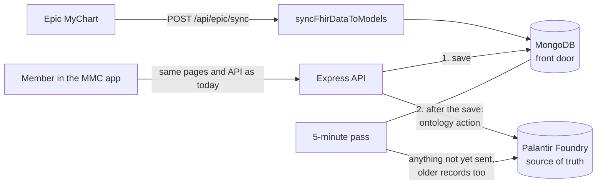

# Foundry bridge: plan

Status: **plan only, not built.** Nothing in this document exists in the code yet. It is the reference for the Foundry bridge tasks that follow.

## 1. The pattern

1. Members use MMC exactly as today. Every write goes to MongoDB first. Mongo stays the **front door**: the app reads from Mongo and never waits on Foundry.
2. After the Mongo save succeeds, the server calls a Foundry **ontology action** (save or delete) for that record. The call runs after the response is sent, so a slow or down Foundry never slows or breaks a member's save.
3. Foundry is the **source of truth** for everything downstream (CareGuide, reporting, analysis). Data only flows Mongo → Foundry in this phase. Nobody edits these objects inside Foundry; only the Foundry account that owns the bridge's token may run the actions (see §8).
4. On success the record gets `foundryRecordedAt` (date). On failure it gets `foundryRecordError` (short message) and stays pending.
5. A **pass every 5 minutes** (node-cron in `server/server.js`, next to the reminder job) sends every record that is not yet sent. The same pass **backfills** records saved before the bridge existed, because they have no `foundryRecordedAt`.
6. Everything sits behind **`FOUNDRY_WRITES=1`**. With the flag unset, no Foundry call is made, the 5-minute pass does not run, and MMC behaves exactly as it does today. The flag is set on Render, never in a file in the repo.
7. **Members never sign in to Foundry.** The server talks to Foundry with one **personal Foundry token** (`FOUNDRY_TOKEN`) from a team member's Foundry account. The stack is on Dev Tier, which cannot create client-credential apps, so there is no service user. Members never see a Foundry login, link or screen.
8. **Health data rule:** until MMC runs on a Foundry environment covered by a signed **HIPAA BAA**, only **test members** are sent (§9).

## 2. Bookkeeping fields added to Mongo

Every record that is sent gets these fields. "Record" means a top-level document, or an array item for the arrays that become their own object type (MedicalHistory conditions, allergies, surgeries and events, documents, bill line items). Arrays that are sent as a JSON property on their parent (saved pharmacies, family history, bill payments; §5.2) have no fields of their own: a change to them marks the parent as changed.

| Field | Type | Meaning |
|---|---|---|
| `foundryKey` | String | The Foundry primary key, set on the first successful save and never changed afterwards (§4). |
| `foundryChangedAt` | Date | Set on every member-facing change. |
| `foundryRecordedAt` | Date | Set when Foundry accepted the latest version. `null` = pending. Cleared on every change. |
| `foundryRecordError` | String | Last failure, cut to 300 characters, no field values copied in. Cleared on success. |

How they are kept right:

- A small Mongoose plugin (`server/models/plugins/foundryTracked.js`) on each sent model sets `foundryChangedAt = now` and `foundryRecordedAt = null` on `save`, `findOneAndUpdate`, `findByIdAndUpdate`, `updateOne` and `updateMany`. Today most edit routes use `findByIdAndUpdate`, which skips the existing `pre('save')` hooks, so the plugin has to hook the query middleware too.
- The same plugin removes any `foundry*` keys from incoming updates. Routes such as `PUT /api/medications/:id`, `PUT /api/appointments/:id` and `PUT /api/medical-bills/:id` pass `req.body` straight into the update, so without this a client could mark its own record as sent.
- For array items, the plugin marks only the items that changed (`isModified` on the sub-document for `save`; the routes that use positional updates, such as `POST /api/documents/event/:eventId`, also set the item's fields).
- Marking a record as sent is conditional: `updateOne({ _id, foundryChangedAt: <value that was sent> }, { $set: { foundryRecordedAt: now, foundryKey }})`. If the member edited it again while the call was in flight, the filter misses and the record stays pending for the next pass.
- Pending query: `{ foundryRecordedAt: null }` for top-level models; `{ conditions: { $elemMatch: { foundryRecordedAt: null } } }` and the like for arrays (a plain `'conditions.foundryRecordedAt': null` would also match documents with an empty array). Each pending field gets an index.

## 3. Deletes

Mongo deletes are hard deletes, so the 5-minute pass cannot find a deleted record afterwards. Two parts:

1. **Top-level deletes** (for example `DELETE /api/medications/:id`): read the `foundryKey` before deleting, delete in Mongo, then call the delete action. If the call fails, write `{ objectType, primaryKey, lastError, attempts }` to a new `FoundryDeleteQueue` collection (keys only, no member data). The 5-minute pass retries the queue.
2. **Array items** (`$pull` of a condition, event, document, line item): the parent counts as changed, so it is sent again. When the parent is sent, the server lists the Foundry child objects linked to it and deletes those that are no longer in Mongo. This also covers `PUT /api/medical-bills/:id`, which can replace `lineItems` wholesale. Removing a saved pharmacy, family-history item or bill payment needs no delete action: the parent is sent again with the item gone from its JSON property.

Bulk deletes must collect keys before they run:

| Where | What it deletes today |
|---|---|
| `DELETE /api/family-members/:id` | Medication, Doctor (`patientId`), Appointment, Insurance, MedicalHistory for that family member, then the FamilyMember |
| `DELETE /api/users/account` | Medication, Doctor, Appointment, Insurance, MedicalHistory, ShareAccess, User |
| Admin user delete (`server/controllers/adminUsers.controller.js`) | MedicalHistory, Medication, Doctor, Appointment, Insurance, ShareAccess, FamilyMember, User |
| `DELETE /api/medical-history/events/:eventId` and `PUT .../events/:eventId` | Medications created by that event (`createdByEventId`) |

Found while reading, **not fixed here** (plan-only run; each needs its own task before its model goes live):

- `DELETE /api/users/account` deletes Doctor with `{ userId }` and ShareAccess with `{ userId }`, but a patient's doctors are stored under `patientId` and shares under `patientId`, so both are left behind. It also leaves FamilyMember, MedicalBill, SettlementOffer and EpicConnection. The bridge must send deletes for what is really deleted, so this route should be fixed first.
- `DELETE /api/family-members/:id` leaves that member's MedicalBill, SettlementOffer, ShareAccess and EpicConnection records.

## 4. Primary keys

Every object type has a string primary key property **`mmcKey`**.

| Record | `mmcKey` |
|---|---|
| **Hand-entered record** (typed in the app, scanned, created by completing an appointment, and every model Epic never writes) | The Mongo `_id` as a 24-character hex string. For array items, the item's own `_id` (Mongoose gives every array item one). |
| **Epic record** (created by `syncFhirDataToModels`) | Built from **`fhirSource.resourceId`**: `<patientKey>:<fhirSource.provider>:<ResourceType>/<fhirSource.resourceId>`, for example `66a1f0c2e4b0a1b2c3d4e5f6:epic:MedicationRequest/eT9xQ2.aBc` |
| **Patient** | The User `_id` (account holder) or the FamilyMember `_id` (family member). This value is the `patientKey` used everywhere else. |

Why the Epic key carries more than the bare `resourceId`:

- The same Epic Practitioner ID shows up for every member who sees that doctor, and each member has their own Doctor document, so the bare ID would clash across members.
- Epic IDs are unique only inside one Epic organisation, and `fhirSource.provider` is just `'epic'` for all 493 health systems.
- Encounters and Immunizations both become MedicalHistory events, and their IDs come from separate FHIR ID spaces.
- `syncFhirDataToModels` already treats `(userId, familyMemberId, provider, resourceId)` as a record's identity when it dedupes. The key uses the same identity, plus the resource type.

The resource type per target: Medication → `MedicationRequest`, condition → `Condition`, allergy → `AllergyIntolerance`, surgery → `Procedure`, event → `Encounter` or `Immunization` (`eventType: 'vaccination'` comes only from `mapImmunization`), Doctor → `Practitioner`. The raw `fhirSource.resourceId` is also kept as the property `fhirResourceId`.

Rules:

- The key is decided on the **first send** and saved as `foundryKey`. After that it never changes. A hand-entered record that the Epic sync later links by name (the `byName` branches in `syncFhirDataToModels`) keeps its `_id` key and gains `fhirResourceId`. If the link happens before its first send, it gets the Epic key.
- Hand-entered keys are 24 hex characters and Epic keys always contain `:`, so they can never clash.
- Links (§5) carry the **target's** `mmcKey`, not its Mongo `_id`. The server uses the target's `foundryKey`, or works it out the same way if the target has not been sent yet. A link to a target that is not in Foundry yet resolves once the target arrives.
- Editing a condition, allergy or surgery in the app is delete-and-add today (see `editsummary-2026-03.txt`), so in Foundry it shows up as one delete and one create with a new key. That is expected. Family-history items are edited the same way, but they live in `familyHistoryJson` on `MmcHealthProfile`, so the profile is simply saved again.

### Where Epic data enters

Epic data enters Mongo in one place: **`syncFhirDataToModels`** in `server/services/fhirMappingService.js`, called from **`POST /api/epic/sync`** (`server/routes/epic.js`) with `providerId = 'epic'`. It writes Medication, the MedicalHistory arrays (conditions, allergies, surgeries, events) and Doctor. The bridge hooks in there in two ways: the plugin marks every record it creates, updates or links, and once the function returns, the route sends the changed records (`POST /api/epic/sync` responds first).

Note for reviewers: `POST /api/insurance/:id/sync` (payer FHIR, for example `provider = 'wellmark'`) calls the same function. Its records get the same key format with their own provider (`...:wellmark:Condition/123`), so they cannot clash with Epic records. That route always passes `familyMemberId = null`, so a family member's payer data lands on the account holder. That is an existing bug to fix before payer data is sent.

## 5. Object types

All API names start with `Mmc`, because the Foundry stack is shared with other projects and object type API names must be unique across it. Property API names are camelCase, and nested Mongo fields are flattened (`dosage.amount` → `dosageAmount`). Lists of plain values stay arrays. Small nested lists that do not need their own type are stored as one JSON string property (marked *json*).

### 5.1 Family member scoping (every object type)

Every object below, except `MmcPatient` itself, carries these properties:

| Property | From Mongo | Notes |
|---|---|---|
| `mmcKey` | see §4 | primary key |
| `mongoId` | `_id` | for tracing back to Mongo |
| `patientKey` | `familyMemberId ?? userId` (Doctor: `familyMemberId ?? patientId`) | foreign key, link to `MmcPatient` |
| `accountUserId` | `userId` (Doctor: **`patientId`**) | the login that owns the record |
| `familyMemberId` | `familyMemberId` | `null` = the account holder's own record, exactly as in Mongo |
| `recordSource` | | `hand-entered`, `epic`, or `payer-fhir` |
| `fhirProvider`, `fhirResourceId`, `fhirLastSynced` | `fhirSource.*` | only on types Epic writes |
| `mmcCreatedAt`, `mmcUpdatedAt` | `createdAt`, `updatedAt` (array items: `addedAt`) | |

**Doctor exception:** Doctor stores its owner in `patientId`, not `userId`. On Doctor, `userId` means "this is a doctor's own account profile". The bridge maps `patientId` to `accountUserId` and never reads Doctor's `userId` as the owner. Doctor profiles that doctors create about themselves (`POST /api/doctors/register`: `userId` set, no `patientId`) are not member health data and are **not sent**.

### 5.2 Mapping

| # | Mongo model (file) | Object type | Primary key | Main properties | Links |
|---|---|---|---|---|---|
| 1 | `User.js` + `FamilyMember.js` | **`MmcPatient`** | User `_id` or FamilyMember `_id` | `mmcKey`, `mongoId`, `patientKind` (`account-holder`/`family-member`), `accountUserId`, `relationship` (family), `role` (User), `firstName`, `lastName`, `email`, `backupEmail`, `phone`, `dateOfBirth`, `gender`, `preferredLanguage`, `race`, `ethnicity`, `maritalStatus`, `occupation`, `employer`, `addressStreet/City/State/ZipCode`, `emergencyContactName/Relationship/Phone`, advance directive flags (`hasLivingWill`, `hasHealthcarePOA`, `healthcarePOAName`, `healthcarePOAPhone`, `isDNR`, `isOrganDonor`), consent flags, dates and versions (`termsAcceptedAt`, `privacyAcceptedAt`, `hipaaAcceptedAt`, ...), `isActive`, `isEmailVerified`, `pharmaciesJson` (*json*: `pharmacies[]` from User or FamilyMember, each with `name`, `phone`, `fax`, address, `isPreferred`), `mmcCreatedAt`, `mmcUpdatedAt` | family member → account holder (`accountUserId` → `MmcPatient`); has many of every type below |
| 2 | `Medication.js` | **`MmcMedication`** | `_id` / Epic key | `name`, `genericName`, `dosageAmount`, `dosageUnit`, `frequency`, `timeOfDay[]`, `prescribedBy`, `prescribedDate`, `pharmacyName`, `pharmacyPhone`, `pharmacyAddress`, `refillsRemaining`, `nextRefillDate`, `purpose`, `sideEffects`, `instructions`, `status`, `ndcCode`, `manufacturer`, `route`, `site`, `category`, `code`, `codeSystem`, `statusReason`, `patientInstruction`, `reminderEnabled`, `reminderTimes[]`, `startDate`, `endDate` | → `MmcPatient`; → `MmcDoctor` (`prescribingDoctorId`); → `MmcAppointment` (`sourceAppointmentId`); → `MmcMedicalEvent` (`createdByEventId`) |
| 3 | `Doctor.js` (patient entries only) | **`MmcDoctor`** | `_id` / Epic key | `name`, `specialty`, `practiceName`, `practiceStreet/City/State/ZipCode`, `phone`, `fax`, `email`, `npiNumber`, `isPrimaryCare`, `notes`, `isVerified` | → `MmcPatient` (via `patientId` / `familyMemberId`) |
| 4 | `Appointment.js` | **`MmcAppointment`** | `_id` | `title`, `doctorName`, `specialty`, `locationName`, `locationAddress`, `locationPhone`, `dateTime`, `durationMinutes`, `appointmentType`, `reason`, `status`, `notes`, `visitSummary`, `prescriptionsJson` (*json*: `prescriptions[]`, each with the linked medication's key) | → `MmcPatient`; → `MmcDoctor` (`doctorId`); → `MmcAppointment` (`parentAppointmentId`, follow-ups); → `MmcMedicalEvent` (`generatedEventId`) |
| 5 | `MedicalHistory.js` (single fields) | **`MmcHealthProfile`** | MedicalHistory `_id` | `bloodType`, `heightValue`, `heightUnit`, `weightValue`, `weightUnit`, social history (`smokingStatus`, `smokingDetail`, `alcoholUse`, `alcoholDetail`, `drugUse`, `drugDetail`, `exerciseFrequency`, `exerciseDetail`, `dietRestrictions`), past medical checklist (one boolean per item, plus `cancerType`, `mentalHealthDetail`, `autoimmuneDetail`), family history checklist (one string array of relatives per item, plus `cancerType`, `otherDetail`), `familyHistoryJson` (*json*: `familyHistory[]`, each with `condition`, `relationship`, `notes`) | → `MmcPatient` (one per patient) |
| 6 | `MedicalHistory.conditions[]` | **`MmcMedicalCondition`** | item `_id` / Epic key | `name`, `diagnosedDate`, `status`, `notes`, `diagnosedBy`, `severity`, `bodySite[]`, `verificationStatus`, `category`, `code`, `codeSystem`, `abatementDate`, `recordedDate` | → `MmcPatient` |
| 7 | `MedicalHistory.allergies[]` | **`MmcAllergy`** | item `_id` / Epic key | `allergen`, `reaction`, `severity`, `allergyType`, `category[]`, `onsetDate`, `recordedBy`, `reactionsJson` (*json*: manifestation + severity list) | → `MmcPatient` |
| 8 | `MedicalHistory.surgeries[]` | **`MmcSurgery`** | item `_id` / Epic key | `procedure`, `date`, `endDate`, `hospital`, `surgeon`, `notes`, `bodySite[]`, `reason`, `outcome`, `code`, `codeSystem` | → `MmcPatient` |
| 9 | `MedicalHistory.events[]` | **`MmcMedicalEvent`** | item `_id` / Epic key | `description`, `eventType`, `date`, `endDate`, `provider`, `providerAddress`, `providerPhone`, `doctorName`, `reason`, `facility`, `dischargeDisposition`, `lotNumber`, `site`, `route`, `manufacturer`, `doseNumber`, `notes`, `prescribedMedicationKeys[]` | → `MmcPatient`; → `MmcDoctor` (`doctorId`); → `MmcAppointment` (`appointmentId`); has many `MmcMedicalDocument` |
| 10 | `events[].documents[]`, `Insurance.documents[]`, `MedicalBill.documents[]` | **`MmcMedicalDocument`** | item `_id` | `parentKind` (`event`/`insurance`/`bill`), `originalName`, `mimeType`, `sizeBytes`, `uploadedAt`, `aiSummary`, `aiKeyFindings[]` / `aiCoverageHighlights[]`, `aiExclusions[]`, `aiQuestions[]`, `aiCostsJson` (*json*), `aiTermsJson` (*json*), `aiAnalyzedAt`. **No `s3Key`, no `filename`** (the stored S3 name). | → `MmcPatient`; → `MmcMedicalEvent` or `MmcInsurancePolicy` or `MmcMedicalBill` |
| 11 | `Insurance.js` | **`MmcInsurancePolicy`** | `_id` | `providerName`, `providerPhone`, `providerWebsite`, `planName`, `planType`, `memberId`, `groupNumber`, `subscriberName`, `subscriberDOB`, `relationship`, `effectiveDate`, `terminationDate`, deductible / out-of-pocket / copay / coinsurance numbers (flattened), `isPrimary`, `isActive`, `payerFhirConnected`, `payerFhirProvider`, `payerFhirLastSynced` | → `MmcPatient`; has many `MmcMedicalDocument`, `MmcMedicalBill` |
| 12 | `MedicalBill.js` | **`MmcMedicalBill`** | `_id` | `billerName`, `billerAddress`, `billerPhone`, `billerWebsite`, `billerPaymentPortalUrl`, `dateOfService`, `dateReceived`, `statementDate`, `dueDate`, `guarantorName`, `guarantorId`, `totalAmountBilled`, `totalInsurancePaid`, `totalInsuranceAdjusted`, `totalPatientResponsibility`, `totalAmountPaid`, `status`, `aiSummary`, `aiErrorsFoundJson` (*json*), `aiEstimatedSavings`, `aiFairPriceTotal`, `aiRecommendedPatientOffer`, `aiAnalyzedAt`, `disputeStatus`, `disputeLetterText`, `disputeDateFiled`, `disputeResolution`, `disputeResolvedAt`, `disputeSavedAmount`, `paymentsJson` (*json*: `payments[]`, each with `date`, `amount`, `method`, `referenceNumber`, `notes`), `notes` | → `MmcPatient`; → `MmcInsurancePolicy` (`insuranceId`); → `MmcAppointment` (`appointmentId`) |
| 13 | `MedicalBill.lineItems[]` | **`MmcBillLineItem`** | item `_id` | `lineIndex`, `description`, `cptCode`, `quantity`, `amountBilled`, `fairPriceEstimate`, `flaggedAsError`, `errorReason` | → `MmcMedicalBill`; → `MmcPatient` |
| 14 | `SettlementOffer.js` | **`MmcSettlementOffer`** | `_id` | `billerName`, `billerEmail`, `status`, `originalBillAmount`, `offerAmount`, `counterAmount`, `finalAmount`, `platformFee`, `patientMessage`, `billerMessage`, `expiresAt`, `otpVerified`, `historyJson` (*json*), guest offers: `guestFirstName`, `guestLastName`, `guestEmail`, `partnerRef` | → `MmcMedicalBill` (`billId`); → `MmcPatient` (empty for guest offers) |
| 15 | `ShareAccess.js` | **`MmcRecordShare`** | `_id` | `shareType`, `recipientName`, `recipientEmail`, permission flags (`shareMedicalHistory`, `shareMedications`, ...), `reasonForVisit`, `status`, `requestedAt`, `approvedAt`, `expiresAt`, `timesAccessed`, `maxAccesses`, `lastAccessedAt`, `isActive`, `accessLogJson` (*json*: time, accessed by, data accessed; **no IP**) | → `MmcPatient` (via `patientId` / `familyMemberId`) |
| 16 | `EpicConnection.js` | **`MmcEpicConnection`** | `_id` | `patientFhirId`, `epicEndpoint`, `healthSystemName`, `scopes`, `patientName`, `status`, `lastSyncAt`, `connectedAt`, `syncHistoryJson` (*json*) | → `MmcPatient` |

### 5.3 MedicalHistory is split

In Mongo, MedicalHistory is **one document per member** (per `userId` + `familyMemberId`), holding `conditions`, `allergies`, `surgeries` and `events` as arrays, plus `familyHistory` and the single-value fields. In Foundry it is split up:

- each **condition** becomes an `MmcMedicalCondition`, each **allergy** an `MmcAllergy`, each **surgery** an `MmcSurgery`, and each **event** an `MmcMedicalEvent`. Every one has its own object, keyed by the array item's `_id` (or its Epic key) and **linked to `MmcPatient`** through `patientKey`;
- the single-value fields (blood type, height, weight, social history, both checklists) and the `familyHistory` list (as `familyHistoryJson`) become one `MmcHealthProfile` per patient;
- each event's `documents[]` become `MmcMedicalDocument` objects linked to the event.

Each array item carries its own `foundryKey` / `foundryChangedAt` / `foundryRecordedAt` / `foundryRecordError` (§2). When an item is removed, the parent is sent again and the server deletes the Foundry objects that are gone (§3).

### 5.4 Mongo models that are not sent

| Model | Why |
|---|---|
| `HealthSystem.js` | Reference list of Epic endpoints, not member data |
| `Admin.js` | MMC staff accounts |
| `NdaAgreement.js` | Investor NDA sign-offs, not members |
| `Doctor.js` entries with `userId` and no `patientId` | A doctor's own profile, not a patient's record (§5.1) |
| `Insurance.fhirData` (raw payer FHIR cache) | Raw copies of bundles. The mapped records already go through `syncFhirDataToModels`. Payer claims live only here; sending them is an open question for James. |

## 6. Fields that never go to Foundry

The bridge builds each payload from an **allow-list** of the properties in §5.2. Anything not listed is not sent, so a new Mongo field stays out until someone adds it on purpose. In particular, these never leave Mongo:

| Kind | Fields |
|---|---|
| Passwords | `User.password`, `Admin.password` |
| Tokens | `User.emailVerificationToken`, `User.passwordResetToken` (and their `...Expires`), `ShareAccess.sessionToken`, `SettlementOffer.sessionToken` (and `sessionExpiresAt`), `ShareAccess.accessCode`, `ShareAccess.qrCodeData`, `SettlementOffer.accessCode` (these codes open a record or offer without login) |
| OTPs | `ShareAccess.otpHash`, `otpAttempts`, `otpLockedUntil`; `SettlementOffer.otpHash`, `otpAttempts`, `otpLockedUntil` |
| Epic and payer tokens | `EpicConnection.accessToken`, `refreshToken`, `tokenExpiresAt`; `Insurance.fhirConnection.accessToken`, `refreshToken`, `tokenExpiry` |
| Stripe ids | `SettlementOffer.billerStripeAccountId`, `stripePaymentIntentId`, `stripeTransferId` |
| S3 keys | `documents[].s3Key` and `documents[].filename` on events, Insurance and MedicalBill; `Insurance.cardImages.front/back` (S3 keys); `User.profileImage`, `FamilyMember.profileImage` |
| Also left out (decided here, a reviewer can change it) | `User.googleId`, `User.appleId`, `User.lastLogin`, `User.consent.ipAddress`, `ShareAccess.accessLog[].ipAddress`, `ssnLast4` (User and FamilyMember), `User.preferredCalendar`, `Appointment.googleCalendarEventId`, `calendarSynced`, `reminders`, `remindersSent`, `Medication.scannedData.rawText` |

`foundryRecordError` never copies field values into the error text, and nothing in the bridge logs a payload.

## 7. Actions

For each object type, two actions with kebab-case API names: **`save-mmc-<type>`** and **`delete-mmc-<type>`**.

- **save** takes `mmcKey` and **every** property (a full overwrite, not a patch). It uses Foundry's **create-or-modify** rule: if no object with that `mmcKey` exists it is created, otherwise it is modified. So the server never has to know whether the object is already in Foundry, a retry after a timeout cannot fail on a duplicate key, and sending the same version twice gives the same result.
- **delete** takes `mmcKey`.
- The server calls save for every new or changed record, and delete only for deletes (§3).

| Object type | Save | Delete |
|---|---|---|
| `MmcPatient` | `save-mmc-patient` | `delete-mmc-patient` |
| `MmcMedication` | `save-mmc-medication` | `delete-mmc-medication` |
| `MmcDoctor` | `save-mmc-doctor` | `delete-mmc-doctor` |
| `MmcAppointment` | `save-mmc-appointment` | `delete-mmc-appointment` |
| `MmcHealthProfile` | `save-mmc-health-profile` | `delete-mmc-health-profile` |
| `MmcMedicalCondition` | `save-mmc-medical-condition` | `delete-mmc-medical-condition` |
| `MmcAllergy` | `save-mmc-allergy` | `delete-mmc-allergy` |
| `MmcSurgery` | `save-mmc-surgery` | `delete-mmc-surgery` |
| `MmcMedicalEvent` | `save-mmc-medical-event` | `delete-mmc-medical-event` |
| `MmcMedicalDocument` | `save-mmc-medical-document` | `delete-mmc-medical-document` |
| `MmcInsurancePolicy` | `save-mmc-insurance-policy` | `delete-mmc-insurance-policy` |
| `MmcMedicalBill` | `save-mmc-medical-bill` | `delete-mmc-medical-bill` |
| `MmcBillLineItem` | `save-mmc-bill-line-item` | `delete-mmc-bill-line-item` |
| `MmcSettlementOffer` | `save-mmc-settlement-offer` | `delete-mmc-settlement-offer` |
| `MmcRecordShare` | `save-mmc-record-share` | `delete-mmc-record-share` |
| `MmcEpicConnection` | `save-mmc-epic-connection` | `delete-mmc-epic-connection` |

That is **32 action types** (16 object types × 2). Server writes that are not member edits still count as changes and get sent: the reminder cron writing `remindersSent` (that field is not sent, so the edit is a no-op), the midnight cron expiring settlement offers (`updateMany`), and the Stripe webhook updating bills and offers.

## 8. Server side (what the build tasks add)

| Piece | Where |
|---|---|
| Foundry client: personal token from `FOUNDRY_TOKEN`, `applyAction(apiName, params)`, list linked objects | `server/services/foundryService.js` |
| Mongo → payload mapping per object type (the allow-lists in §5.2), key rules (§4), test-member gate (§9) | `server/services/foundryBridge.js` |
| Bookkeeping plugin (§2) | `server/models/plugins/foundryTracked.js` |
| Delete retry queue (§3) | `server/models/FoundryDeleteQueue.js` |
| 5-minute pass: delete queue first, then pending records in dependency order (Patient → Doctor → Appointment → HealthProfile and MedicalHistory items → Medication → Insurance → Bill and its items → Offer → Document → Share → EpicConnection), oldest first, a capped number per type per pass so backfill runs in steady slices | `server/server.js` cron, `*/5 * * * *` |
| Test-member flag | `User.foundryTestMember` (Boolean, default `false`), set only by an admin |

Settings (names only, values set on Render, **never** in a file in the repo): `FOUNDRY_WRITES` (`1` turns the bridge on), `FOUNDRY_TOKEN` (the personal Foundry token), `FOUNDRY_URL`, `FOUNDRY_ONTOLOGY_RID`.

The Foundry account that owns `FOUNDRY_TOKEN` is the only identity allowed to run the 32 actions. No member account exists in Foundry. A personal token expires or can be revoked; when that happens every call fails with a `foundryRecordError`, records stay pending, and the 5-minute pass sends them once a new token is set on Render.

## 9. Health data rule: test members only until there is a BAA

Until MMC runs on a Foundry environment covered by a **signed HIPAA BAA**:

- The bridge sends a record only when its account holder has `User.foundryTestMember = true`. Family members follow their account holder. Guest settlement offers have no account holder, so they are not sent.
- Test members are accounts the team creates with **made-up data only**. A test member's Epic records are sent only when their `EpicConnection.epicEndpoint` is the Epic sandbox (`fhir.epic.com`). Payer FHIR records are not sent at all in this period.
- Records of other members are **skipped, not marked as failed**. They keep `foundryRecordedAt: null` and stay out of the pass's query, so the backfill picks them up once the gate is lifted.
- Lifting the gate is a **code change** in `foundryBridge.js` (not a setting), in a pull request that names the signed BAA and the Foundry environment it covers.

## 10. Foundry folder

All 16 object types, their backing datasources, and the 32 actions go in **`/Silverfoxmedia-af07b2/MyMedicalCabinet/03 Ontology`**.

**Foundry ids are reserved even after a branch is archived.** An id used by a failed attempt (an object type id, for example) cannot be reused; Foundry refuses it with `OntologyMetadata:ObjectTypesAlreadyExist`. Pick a new id instead. This is why the pilot's object type id is `mmc-medication-object`, not `mmc-medication` (its API name is still `MmcMedication`).

## 11. How many object types

**16 object types** (table in §5.2). The Foundry stack is shared with other projects and allows **60 object types**; **42 are already used**, so at most **18** can be added. MMC uses 16, leaving 2 spare.

To fit, three arrays that could have been object types are sent as JSON properties on their parent. The cost is that they cannot be queried as objects of their own:

- saved pharmacies → `pharmaciesJson` on `MmcPatient`
- family history → `familyHistoryJson` on `MmcHealthProfile`
- bill payments → `paymentsJson` on `MmcMedicalBill`

## 12. Build order

Each step is its own task and ships behind `FOUNDRY_WRITES=1`.

0. **Before any code:** `FOUNDRY_TOKEN`, `FOUNDRY_URL` and `FOUNDRY_ONTOLOGY_RID` set on Render (§8). At least one test member with made-up data. BAA status known.
1. **Shared plumbing, no object types yet:** `foundryService.js`, `foundryBridge.js` skeleton, the `foundryTracked` plugin, `FoundryDeleteQueue`, the 5-minute pass, the test-member gate, and the `foundry*` body stripping.
2. **Pilot: `MmcMedication`.** In Foundry: the object type plus `save-mmc-medication` and `delete-mmc-medication`. In MMC, every path that writes medications:
   - `POST /api/medications` and `POST /api/medications/scan`
   - `PUT /api/medications/:id`, `PUT /api/medications/:id/status`, `PUT /api/medications/:id/reminder`
   - `DELETE /api/medications/:id`
   - medications created and removed by `POST`/`PUT`/`DELETE /api/medical-history/events`
   - `PUT /api/appointments/:id/complete`
   - the Epic sync (create, update, link by name)
   - the family-member and account cascades
   - backfill of existing medications

   `patientKey` is stored as a plain property until step 3 adds the link.

   **Exit check:** on a test member, each path above shows up in Foundry within one pass. Turning off Foundry access gives a `foundryRecordError`, and the record is sent once access is back. A non-test member's medications are never sent.
3. **`MmcPatient`** (with `pharmaciesJson`): add the Patient link to `MmcMedication`. Fix the account-delete cascade (§3) first.
4. **MedicalHistory split:** `MmcHealthProfile`, `MmcMedicalCondition`, `MmcAllergy`, `MmcSurgery`, `MmcMedicalEvent` (family history goes in `familyHistoryJson` on the profile). This step completes the Epic sync.
5. **`MmcDoctor` and `MmcAppointment`.**
6. **Bills:** `MmcMedicalBill` (with `paymentsJson`), `MmcBillLineItem`, `MmcSettlementOffer`. CareGuide works mainly with bills, so James may want this step right after step 3.
7. **`MmcInsurancePolicy`.** Fix the payer-sync `familyMemberId` bug (§4) first.
8. **`MmcMedicalDocument`** (events, insurance, bills).
9. **`MmcRecordShare` and `MmcEpicConnection`.**
10. **All members:** only after the BAA. Lift the gate (§9); the 5-minute pass then backfills everyone in slices.

## 13. Open questions for James

- Is the HIPAA BAA in place, and for which Foundry environment?
- Should payer claims (`Insurance.fhirData.claims`) be sent?
- Should `ssnLast4` stay out (current plan) or go in?
- Should bills (step 6) move up to right after step 3 for CareGuide?
